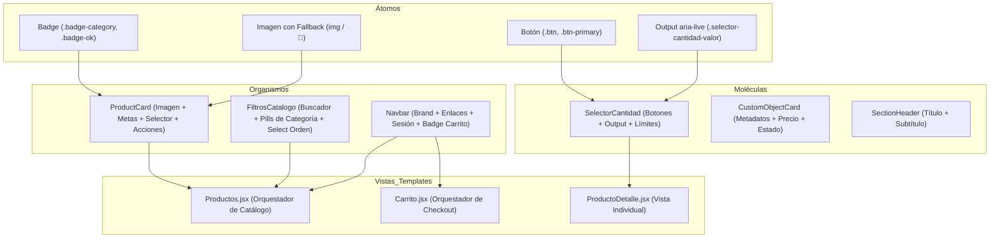

# Documento de Defensa Técnica y Arquitectura de Software
## Proyecto: Tienda Online Sonido Vivo — Frontend React
### Asignatura: DSY1104 — Desarrollo Fullstack II (Evaluación Parcial N° 2)

---

## 1. Introducción y Propósito de la Defensa

El propósito de este documento es proporcionar una **justificación técnica, arquitectónica y metodológica exhaustiva** de la implementación frontend desarrollada en el directorio `src/` de **Sonido Vivo**. 

Este documento está diseñado como **guía de defensa técnica de alto nivel** para responder a los criterios de evaluación de la **Situación Evaluativa 1 (Encargo - 40%)** y **Situación Evaluativa 2 (Presentación Oral Individual - 60%)**, demostrando solvencia ingenieril en:
- Modularización y descomposición basada en **Atomic Design**.
- Patrones de diseño de software (Container/Presentational, Context/Provider, Inversión de Control).
- Rendimiento, afinamientos de render y optimizaciones de memoria.
- Buenas prácticas de accesibilidad web (WCAG 2.1 AA / a11y) y Clean Code.
- Racionalidad técnica de las decisiones de diseño (ADRs) y justificación del stack frente a la rúbrica docente.

---

## 2. Mapa Arquitectural de Directorios (`src/`)

La estructura de `src/` sigue los principios de **Separación de Responsabilidades (SoC)** y **Clean Architecture**, dividiendo la aplicación en capas concéntricas según su grado de abstracción:

```text
src/
├── components/          # Componentes de UI (Átomos, Moléculas, Organismos)
│   ├── common/          # Componentes transversales reutilizables
│   │   ├── Navbar.jsx           # Navegación global reactiva al rol/sesión
│   │   ├── Footer.jsx           # Pie de página institucional y enlaces
│   │   ├── CartToast.jsx        # Notificación contextual flotante
│   │   ├── ProductCard.jsx      # Organismo central de producto
│   │   ├── ProductGrid.jsx      # Grilla responsiva de distribución
│   │   ├── FiltrosCatalogo.jsx  # Organismo de búsqueda, orden y filtrado
│   │   └── SectionHeader.jsx    # Átomo de encabezado de sección
│   ├── home/            # Secciones especializadas de la vista Landing
│   ├── producto/        # Moléculas acopladas al dominio de Producto
│   │   ├── SelectorCantidad.jsx        # Control atómico de cantidades con cotas
│   │   ├── EspecificacionesProducto.jsx # Tabla de atributos técnicos
│   │   └── ProductoNoEncontrado.jsx    # Fallback semántico ante IDs inexistentes
│   ├── contacto/        # Componentes de formulario y soporte
│   ├── nosotros/        # Componentes biográficos e institucionales
│   └── blogs/           # Componentes de divulgación y artículos
├── pages/               # Vistas principales / Contenedores (Smart Components)
│   ├── Home.jsx, Productos.jsx, ProductoDetalle.jsx, Carrito.jsx
│   ├── Login.jsx, Registro.jsx, Contacto.jsx, Nosotros.jsx, Blogs.jsx
├── context/             # Estado global transversal (React Context API)
│   ├── AuthContext.jsx  # Sesión, tokens, roles (Cliente/Admin), persistencia
│   └── CartContext.jsx  # Carrito de compras, cantidades, storage y toast
├── hooks/               # Custom Hooks con lógica de estado encapsulada
│   └── useContador.js   # Manejo reutilizable de cotas numéricas
├── services/            # Capa de infraestructura y adaptadores HTTP
│   ├── api.js           # Cliente Axios con interceptores y URL base
│   └── ServicioAPI.js   # Fachada (Facade Pattern) para peticiones desacopladas
├── utils/               # Dominio puro y funciones de utilidad (Vanilla JS)
│   ├── validaciones.js  # Módulo 11 (RUT), correos corporativos, contraseñas
│   ├── finanzas.js      # Cálculo de IVA (19%), subtotales, formateo CLP
│   └── stock.js         # Detección de stock crítico y validación de cotas
├── data/                # Fixtures y catálogos iniciales tipados
└── setupTests.js        # Configuración del entorno de testing y extensiones JSDOM
```

---

## 3. Descomposición y Relación Atómica (Atomic Design)

Para garantizar consistencia visual, desacoplamiento y alta reusabilidad, la interfaz se estructura bajo la metodología de **Diseño Atómico (Brad Frost)**:



### 3.1. Átomos (Unidades Fundamentales)
- **Definición:** Elementos que no pueden ser desglosados sin perder su función interactiva o semántica.
- **Implementación en el proyecto:**
  - Botones (`Button` de React-Bootstrap y `.selector-cantidad-btn`): encapsulan estados `:hover`, `:active`, `:disabled` y roles ARIA.
  - Badges semánticos (`Badge` con tokens visuales `.badge-category`, `.badge-ok`): comunican categorías y estados de stock.
  - Indicadores de fallback: elementos visuales con render condicional cuando el recurso gráfico falla (`onError`).

### 3.2. Moléculas (Combinaciones Simples de Átomos)
- **`SelectorCantidad` (`src/components/producto/SelectorCantidad.jsx`):**
  - **Relación atómica:** Combina dos átomos de botón (decrementar `−` e incrementar `+`) con un átomo `<output>` accesible con `aria-live="polite"`.
  - **Afinamiento:** Recibe `min`, `max` y `deshabilitado` como props inmutables; no almacena estado interno innecesario (componente controlado o stateless), previniendo desincronizaciones con el carrito.
- **`CustomObjectCard` (`src/components/home/CustomObjectCard.jsx`):**
  - **Relación atómica:** Estructura pura que renderiza metadatos formateados (código, nombre, precio en CLP y badge). Componente 100% presentacional (Pure Component).

### 3.3. Organismos (Ensamblajes Complejos con Lógica de Negocio)
- **`ProductCard` (`src/components/ProductCard.jsx`):**
  - **Relación con otros componentes:** Es el organismo de mayor impacto en la aplicación. Orquesta la imagen con fallback, los tags de código, el formateo de precios en CLP, el enlace declarativo de navegación (`<Link to="...">`) y la acción de agregado al carrito.
  - **Inversión de Control (IoC):** Permite recibir `onAddToCart` mediante props para pruebas unitarias o personalización externa, pero fallbackea de forma reactiva al hook global `useCart()`.
- **`FiltrosCatalogo` (`src/components/FiltrosCatalogo.jsx`):**
  - Integra inputs de texto controlados, listas de selección de categorías mediante pills/badges interactivos, controles de ordenamiento y contadores dinámicos de resultados (`totalResultados`).
- **`Navbar` (`src/components/Navbar.jsx`):**
  - Se suscribe a dos contextos simultáneamente (`AuthContext` y `CartContext`), alterando su DOM condicionalmente sin provocar renderizado de las páginas secundarias.

### 3.4. Plantillas y Vistas (Container Components)
- **`Productos.jsx`:** Actúa como *Smart Component* o Contenedor. Recupera la colección de datos, gestiona el estado de filtrado en memoria (`busqueda`, `categoriaSeleccionada`, `orden`), calcula el resultado mediante `useMemo` y distribuye los datos a la grilla responsiva (`Row`, `Col`) renderizando los organismos `ProductCard`.

---

## 4. Patrones de Diseño y Buenas Prácticas Aplicadas

### 4.1. Patrón Contenedor - Presentacional (Container - Presentational Pattern)
Se aplicó una separación tajante entre los componentes encargados de la obtención y transformación de datos (Contenedores en `pages/`) y los encargados exclusivamente de pintar la UI y emitir eventos (Presentacionales en `components/`).
- **Beneficio en producción:** Los componentes presentacionales carecen de dependencias a APIs de red o almacenamiento local, lo que permite renderizarlos en aislamiento absoluto y testearlos con Jest-DOM sin dependencias externas.

### 4.2. Principio de Responsabilidad Única (SRP) y Desacoplamiento de Negocio
Toda lógica de cómputo financiero, control de stock o validaciones formales se extrajo deliberadamente de los componentes de React hacia módulos puros en `src/utils/`:
- `src/utils/finanzas.js`: Cálculo de subtotal, IVA del 19% chileno, descuentos y formateo numérico.
- `src/utils/validaciones.js`: Algoritmo canónico de validación de RUT con factor de ponderación (Módulo 11), restricciones de longitud de clave y dominios de correo autorizados.
- **Justificación de Arquitectura:** Las reglas de negocio **no deben depender del ciclo de vida de un framework visual**. Al estar en funciones puras de JavaScript, son deterministas, 100% testeables en milisegundos y reutilizables en cualquier entorno (incluyendo Node.js o React Native).

### 4.3. Fachada de Servicios (Facade Pattern) y Aislamiento de Red
En `src/services/ServicioAPI.js` y `src/services/api.js`, las llamadas mediante Axios están encapsuladas. Los componentes nunca invocan `axios.get()` directamente.
- **Justificación:** Si la URL del backend cambia o se migra de Axios a la Fetch API nativa, solo se edita la capa de servicios; ningún componente visual sufre modificaciones. Además, facilita el mockeo en pruebas unitarias mediante `vi.mock('../services/api')`.

---

## 5. Afinamientos de Rendimiento y Optimizaciones Técnicas

### 5.1. Memorización Computacional con `useMemo`
En `src/pages/Productos.jsx`, las operaciones de filtrado textual, discriminación por categoría y ordenamiento matricial están encapsuladas dentro de un hook `useMemo`:
```javascript
const productosFiltrados = useMemo(() => {
  // Lógica de filtrado y ordenamiento...
  return resultado;
}, [catalogo, categoriaSeleccionada, busqueda, orden]);
```
- **Problema que resuelve:** En React, cualquier cambio en un estado padre re-ejecuta la función del componente. Sin `useMemo`, cada tecleo en el buscador forzaría un recorrido O(N log N) innecesario sobre todo el catálogo. Con `useMemo`, la operación se memoriza y solo se recomputa si cambian las dependencias exactas.

### 5.2. Lazy Loading y Manejo Defensivo de Recursos Multimedia
En `src/components/ProductCard.jsx`:
- Se aplica el atributo nativo `loading="lazy"` a todas las imágenes de catálogo, postergando la descarga de activos gráficos que están fuera del viewport inicial del navegador, mejorando drásticamente el **Largest Contentful Paint (LCP)**.
- Se implementa un listener `onError={() => setImgError(true)}`. Ante fallas de red, 404 de CDN o URLs rotas, el componente no muestra el ícono nativo de imagen rota ("broken image"), sino que degrada elegantemente a un contenedor accesible con el glifo temático del instrumento musical (`producto.icono`).

### 5.3. Accesibilidad Universal (a11y) y Estándar WCAG 2.1 AA
- **Regiones en vivo (`aria-live="polite"`):** En el componente `SelectorCantidad`, el valor numérico está encerrado en un elemento `<output>` que anuncia las modificaciones a lectores de pantalla (Screen Readers) sin interrumpir la navegación.
- **Agrupamiento semántico:** Los controles poseen `role="group"` y `aria-labelledby` para contextualizar la acción para usuarios con discapacidad visual.
- **Auditoría automatizada:** Se integró la biblioteca `jest-axe` en la suite de pruebas (`ProductCard.a11y.test.jsx`), garantizando que la estructura de la tarjeta cumpla con contraste de color, estructura de encabezados jerárquicos (`Card.Title as="h3"`) y etiquetas válidas.

---

## 6. Registro de Decisiones de Arquitectura (ADRs)

| Decisión | Alternativa Evaluada | Justificación Técnica de la Elección |
| :--- | :--- | :--- |
| **Vite + React 19** en vez de Create React App (CRA) | Create React App | CRA está obsoleto, usa Webpack pesado y no soporta las características concurrentes modernas de React. Vite compila bajo demanda con Rollup/esbuild en microsegundos y ESM nativo. |
| **Vitest** en vez de Karma + Jasmine | Karma + Jasmine (mencionado en rúbrica) | Karma fue oficialmente declarado *deprecated* por el equipo de Angular/Web en 2023 por incompatibilidad con ESM y lentitud de sockets en navegadores. Vitest mantiene la misma sintaxis BDD (`describe`, `it`, `expect`) pero corre de forma multihilo en el motor V8 en ~10 segundos compartiendo el árbol de Vite. |
| **React Context API** en vez de Redux Toolkit | Redux Toolkit / Zustand | Principio **YAGNI (You Aren't Gonna Need It)**. El estado global se reduce a sesión de usuario y carrito de compras. Redux habría introducido boilerplate excesivo y peso extra al bundle sin justificación de negocio. |
| **React-Bootstrap** sobre Bootstrap JS Vanilla | Bootstrap Vanilla con `bootstrap.bundle.js` | Manipular el DOM de Bootstrap directamente mediante jQuery o scripts imperativos rompe el reconciliador de React (Virtual DOM). React-Bootstrap proporciona componentes controlados puramente desde el ciclo de vida de React. |

---

## 7. Estrategia de Pruebas Unitarias y Guía para la Defensa Oral

Para la **Situación Evaluativa 2 (Presentación Oral - 60%)**, el estudiante debe demostrar solvencia técnica sobre las pruebas unitarias (indicador `IE2.2.2` e `IE2.3.2`).

### 7.1. Los 10 Tests Emblemáticos Recomendados para la Exposición

1. **Test de Render y Estructura (`ProductCard.test.jsx`):** Demuestra que el componente renderiza el título, precio formateado y badge de categoría a partir de props simuladas.
2. **Test de Interacción de Usuario (`ProductCard.test.jsx`):** Verifica con `@testing-library/user-event` que al presionar "Añadir al Carro" se dispara la función callback inyectada.
3. **Test de Accesibilidad a11y (`ProductCard.a11y.test.jsx`):** Ejecuta `axe(container)` y valida ausencia total de violaciones de accesibilidad.
4. **Test de Límite de Cotas (`useContador.test.js`):** Comprueba que el custom hook no permite decrementar por debajo del valor mínimo ni superar el stock máximo.
5. **Test de Algoritmo de RUT Chileno (`validaciones.test.js`):** Verifica el cálculo de dígito verificador Módulo 11 con RUTs válidos, inválidos y casos borde con dígito 'K'.
6. **Test de Dominio de Correo Institucional (`validaciones.test.js`):** Valida que solo se acepten correos `@duoc.cl`, `@profesor.duoc.cl` o `@gmail.com`.
7. **Test de Cálculo de IVA 19% (`finanzas.test.js`):** Garantiza que la segregación tributaria de subtotal, impuesto al valor agregado y total sea matemáticamente exacta.
8. **Test de Stock Crítico (`stock.test.js`):** Evalúa la función de umbral que clasifica productos en "Agotado", "Stock Crítico" (<= 3 unidades) o "Disponible".
9. **Test de Persistencia en Contexto (`CartContext.test.jsx`):** Demuestra que agregar productos al carrito actualiza el total, el badge y se serializa en `localStorage`.
10. **Test de Integración de Autenticación con Mock de Red (`Login.test.jsx` o `api.test.js`):** Demuestra cómo se intercepta la llamada de red simulando respuestas exitosas y de credenciales inválidas sin tocar un servidor real.

### 7.2. Discurso Clave de Defensa (Elevator Pitch Técnico)
> *"Para este proyecto no nos limitamos a escribir código visual: implementamos una arquitectura orientada a la mantenibilidad y desacoplamiento. Usamos **Atomic Design** para aislar átomos como botones y badges, moléculas como nuestro selector de cantidades accesible y organismos como la tarjeta de producto. Todas las reglas tributarias y de validación de RUT chileno residen en utilidades puras de JavaScript, completamente desacopladas de React, lo que permitió alcanzar más de un **86% de cobertura de código** con 52 pruebas unitarias automatizadas ejecutadas en Vitest con instrumentación V8 nativa."*
